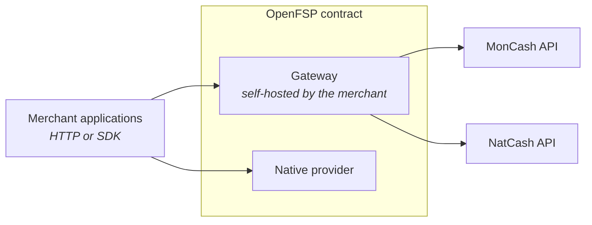

<picture>
  <source media="(prefers-color-scheme: dark)" srcset="https://cdn.openfsp.org/logo/openfsp-logo-inverse.svg">
  
</picture>

**An open standard for payment integration in Haiti**

OpenFSP is one open contract between merchant applications and Haitian payment service
providers. A provider implements it once; a merchant application speaks it once and works
with every compatible provider.

This repository holds the governance: who decides, how decisions are made, and what
adopters can rely on.

## The idea

Without a shared contract, each of `L` merchant applications integrates each of `O`
providers: `O × L` integrations. With OpenFSP, each application speaks one protocol and
each provider implements that contract once: `O + L`.

A native provider speaks OpenFSP directly. Until providers do, the gateway translates the
contract into the existing MonCash and NatCash APIs, so it is usable today.

## Components

| Component | Role |
|---|---|
| **Specification** | The contract: data model, lifecycle, capabilities, errors, idempotency, webhooks, authentication, conformance. |
| **Gateway** | One implementation, self-hosted by the merchant: OpenFSP in, MonCash and NatCash APIs out. |
| **Simulator** | Plays the providers, failures included, and a native OpenFSP provider, for testing without a merchant account. |
| **SDKs** | The next step: Kotlin for the JVM first, then TypeScript. The protocol also works over plain HTTP. |
| **Conformance suite** | Checks a gateway or a native provider against the specification; anyone can rerun it. |

## Links

- Specification, decisions and status: [openfsp.org](https://openfsp.org)
- Code: [openfspht/openfsp](https://github.com/openfspht/openfsp)
- Governance: [GOVERNANCE.md](GOVERNANCE.md), [CONTRIBUTING.md](CONTRIBUTING.md),
  [SECURITY.md](SECURITY.md)
- License: [Apache-2.0](LICENSE)

I take reviews and proposals through the decision process described in
[CONTRIBUTING.md](CONTRIBUTING.md).
